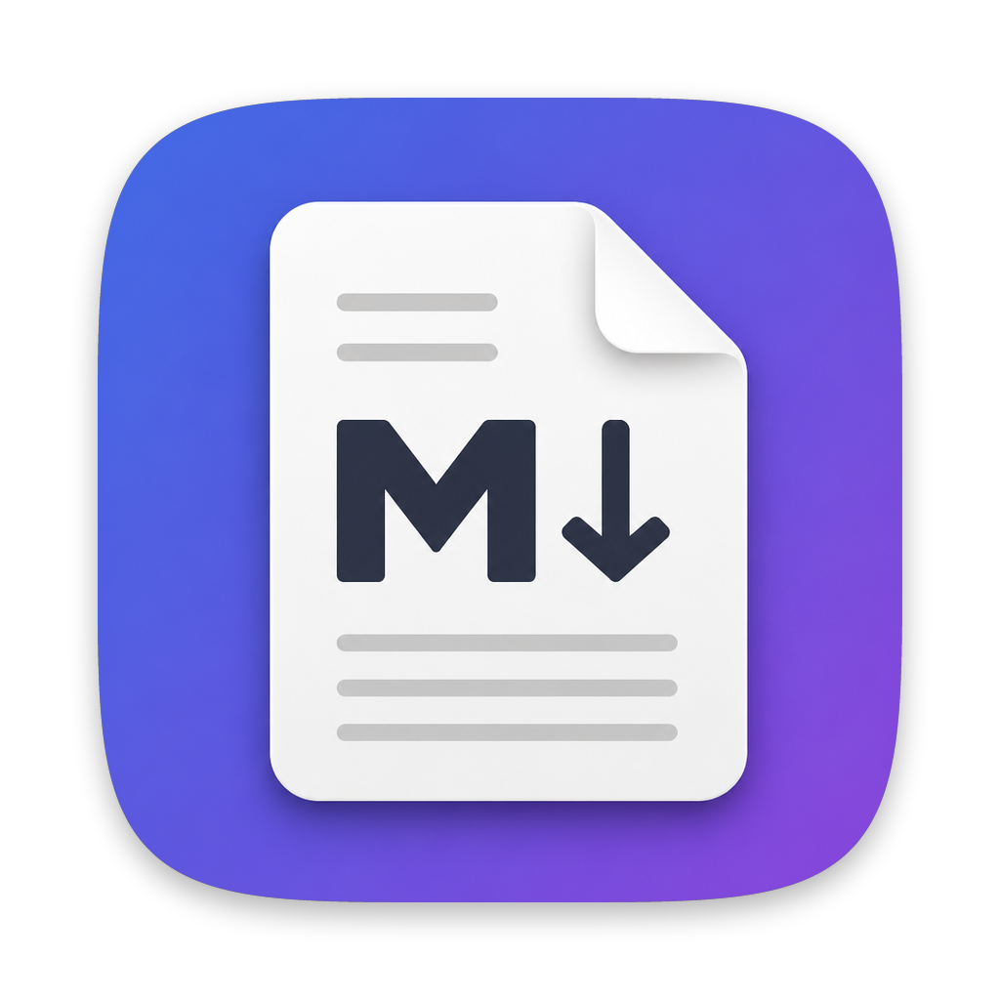
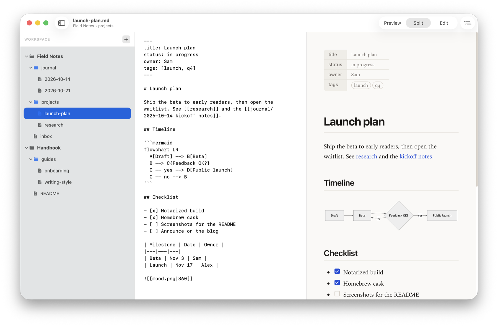
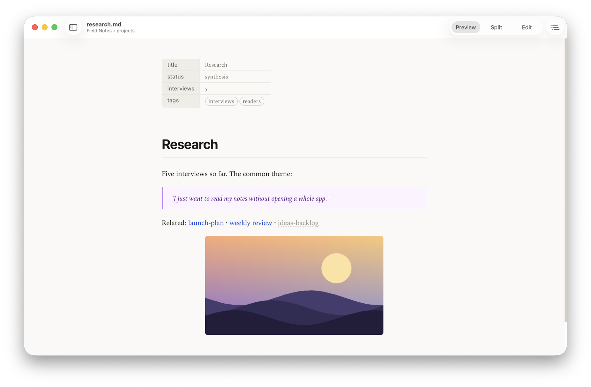
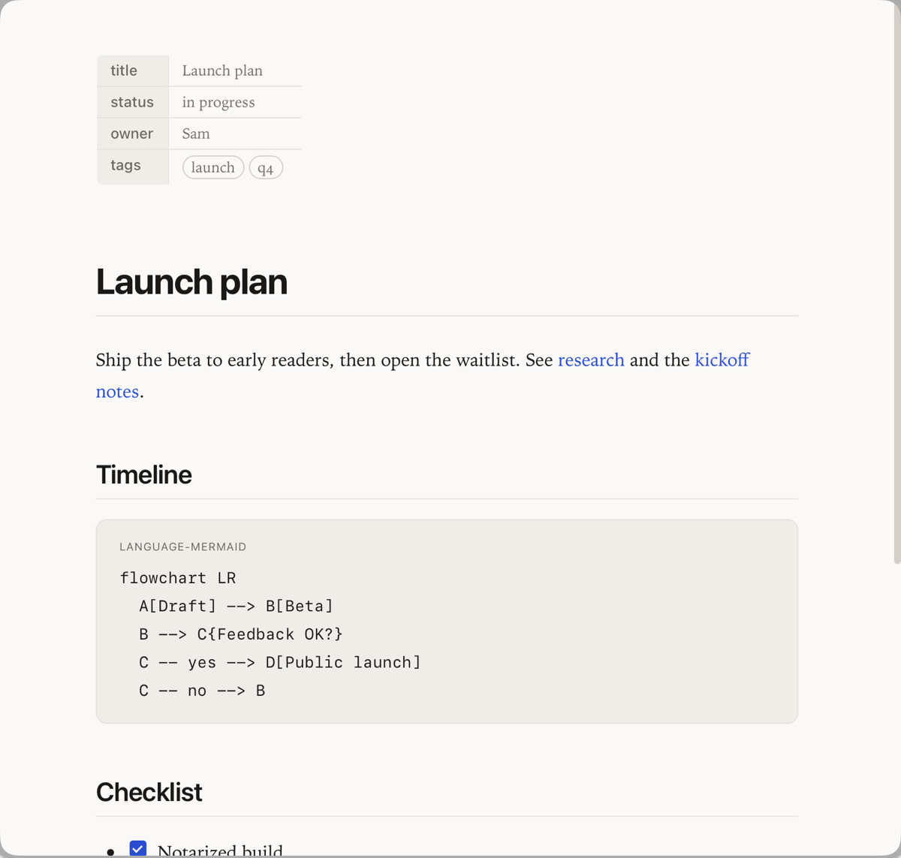
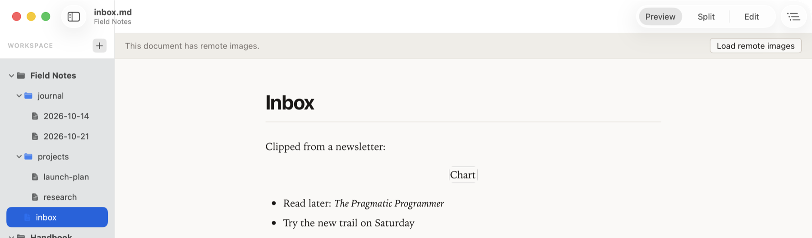

<div align="center">



<h1>PreviewMD</h1>

**The missing Markdown viewer for macOS — free, native, private, and Obsidian-friendly.**

[](https://github.com/ychani/Preview-md/releases/latest)
[](https://github.com/ychani/Preview-md/releases)


[](LICENSE)
[](https://github.com/ychani/Preview-md/actions/workflows/ci.yml)

[Install](#install) · [Features](#features) · [Quick Look](#quick-look) · [Privacy](#privacy) · [FAQ](#faq) · [Contributing](#contributing)

</div>

<picture>
  
</picture>

PreviewMD is a small native Mac app for reading Markdown: open a file or a whole folder of notes and read them rendered, with wikilinks, Mermaid diagrams, and live reload. It also adds a Quick Look extension, so you can press Space on a `.md` file in Finder to preview it.

## Why PreviewMD?

Many Markdown apps are editors or note-taking tools. PreviewMD is a reader first: it opens your files where they are, with nothing to import. Here is how it compares with some well-known Mac apps:

| | PreviewMD | [QLMarkdown](https://github.com/sbarex/QLMarkdown) | [MacDown](https://github.com/MacDownApp/macdown) | [Typora](https://typora.io) | [Obsidian](https://obsidian.md) |
|---|:-:|:-:|:-:|:-:|:-:|
| Built for | Reading | Quick Look | Editing | Editing | Knowledge base |
| App window to read files | ✅ | ❌¹ | ✅ | ✅ | ✅ |
| Quick Look preview | ✅ | ✅ | — | — | — |
| Folder explorer | ✅ | ❌ | — | ✅ | ✅ |
| Wikilinks | ✅ | ✅ | — | — | ✅ |
| Free | ✅ | ✅ | ✅ | Paid, with trial | ✅² |
| Open source | ✅ MIT | ✅ GPL-3.0 | ✅ MIT | — | ❌ |
| Native macOS app | ✅ | ✅ | ✅ | — | ❌ Electron |

<sub>✅ yes · ❌ no · — not stated in the project's own README or website. Taken from each project's README, website, or help pages in October 2026. Corrections are welcome.<br>
¹ QLMarkdown's app is for configuring its previews and says it is not meant to be a standalone viewer. ² Obsidian is free; a commercial license is optional.</sub>

All of these are good apps. Use PreviewMD when you want to read Markdown, including an Obsidian vault, without opening an editor or a note-taking app.

## Install

### Homebrew

```bash
brew install --cask ychani/tap/previewmd
```

### Download

Download the notarized `PreviewMD-<version>.dmg` from [GitHub Releases](https://github.com/ychani/Preview-md/releases), open it, and drag PreviewMD to Applications.

> [!NOTE]
> PreviewMD needs macOS 13 Ventura or later. It is a universal app that runs natively on Apple silicon and Intel Macs.

### Enable Quick Look

1. Launch PreviewMD once from Applications so macOS registers its Quick Look extension.
2. Press Space on any `.md` file in Finder.
3. If the preview doesn't appear, make sure the extension is turned on: **System Settings → General → Login Items & Extensions → Quick Look** (macOS 15+) or **System Settings → Privacy & Security → Extensions → Quick Look** (macOS 13–14).

> [!TIP]
> Still seeing an old preview or plain text? Reset Quick Look with `qlmanage -r && qlmanage -r cache`, then try again.

<details>
<summary>Uninstall / upgrading from Preview-MD</summary>

**Uninstall with Homebrew** (add `--zap` to also remove preferences):

```bash
brew uninstall --cask previewmd
```

**Uninstall manually:**

```bash
rm -rf /Applications/PreviewMD.app ~/Applications/PreviewMD.app
defaults delete com.narnarlabs.previewmd 2>/dev/null || true
qlmanage -r && qlmanage -r cache         # refresh Quick Look
```

**Upgrading from Preview-MD:** the app was renamed, and its bundle ID changed from `com.preview-md.app` to `com.narnarlabs.previewmd`. Delete the old `Preview-MD.app` and its preferences. If you don't, Finder may keep using the old Quick Look extension.

```bash
rm -rf ~/Applications/Preview-MD.app
defaults delete com.preview-md.app 2>/dev/null || true
```

</details>

## Features

### Reading & editing

- **Preview, Split, and Edit views** (⌘1 / ⌘2 / ⌘3) with GitHub-style rendering that follows light and dark mode.
- **Auto-reload** follows changes made in another app and asks first if you have unsaved edits.
- **Encoding-aware saving** keeps a file's original encoding (UTF-8, UTF-16, Latin-1/CP-1252, or Shift-JIS), byte-order mark, and line endings.

### Explorer & workspace

- **Folder tree** lists every Markdown file in a folder and its subfolders, VS Code style. It skips hidden folders and `node_modules` and handles up to 20,000 files.
- **Live updates** show new, deleted, and renamed files within about a second, and your expanded folders and selection stay put.
- **Multi-root workspace**: add more folders as top-level roots (⌥⌘O). Your workspace is restored on the next launch.

### Obsidian-friendly

- **Wikilinks** such as `[[note]]`, `[[note|alias]]`, `[[note#heading]]`, and `[[folder/note]]` resolve across your workspace the way Obsidian resolves them. Links to missing notes are dimmed.
- **Image embeds** like `![[image.png|300]]` load from anywhere in the same workspace folder, including `attachments/`.
- **Front matter** at the top of a note appears as a compact properties table.



### Diagrams & navigation

- **Mermaid diagrams** are drawn right in the preview.
- **Table of contents** panel and **Find** (⌘F, ⌘G / ⇧⌘G).
- **Links that work**: `#heading` links scroll in place, links to other `.md` files open them in PreviewMD, and relative images load from disk.

### Safety & accessibility

- **Data-loss guards** ask before you switch files or quit with unsaved edits, and before you overwrite a file that changed on disk. Files over 5 MB open read-only.
- **VoiceOver labels** on the toolbar, sidebar, Find bar, and table of contents, and faint text that meets WCAG AA contrast.

## Quick Look

Select a Markdown file in Finder and press Space to see it rendered, front-matter table included. See [Enable Quick Look](#enable-quick-look) if nothing happens.

Quick Look previews are meant to be fast and safe, so they are more limited than the app:

- Rendering is static. The preview runs no JavaScript, so **Mermaid diagrams are not drawn**.
- Wikilinks and embeds show as styled text and can't be clicked.
- Remote content is never loaded.
- Files over 2 MB are cut off, with a note saying so.



## Privacy

- **No telemetry, accounts, or update checks.** PreviewMD makes no network requests of its own, and all of its rendering libraries are bundled.
- **Remote images are blocked** until you choose **Load remote images** for that document. The choice is never saved.
- **Safe rendering:** HTML in your documents is cleaned with DOMPurify, and the preview runs under a strict Content-Security-Policy. If the sanitizer is unavailable, the document is shown as plain text.
- **Local images** load only from inside the document's workspace folder (or its own folder), and only image files.
- Links open in your browser only when you click them.



## Keyboard shortcuts

| Shortcut | Action |
|----------|--------|
| ⌘O | Open file or folder… |
| ⌥⌘O | Add Folder to Workspace… |
| ⌘S | Save |
| ⌘1 / ⌘2 / ⌘3 | Preview / Split / Edit |
| ⌘F | Find in preview |
| ⌘G / ⇧⌘G | Next / previous match |
| ⌘+ / ⌘− / ⌘0 | Zoom in / zoom out / actual size |
| ⌥⌘R | Reveal in Finder |
| ⌥⌘C | Copy Path |
| ⇧⌥⌘C | Copy Relative Path (file inside the workspace) |

## FAQ

**Quick Look doesn't show my file rendered.**
Launch PreviewMD once from Applications, make sure the extension is turned on (see [Enable Quick Look](#enable-quick-look)), then run `qlmanage -r && qlmanage -r cache`. If another Markdown Quick Look extension is installed, Finder may pick that one instead.

**I used Preview-MD before, and Finder still shows the old preview.**
The old `Preview-MD.app` has its own Quick Look extension. Delete it as shown under [Uninstall / upgrading from Preview-MD](#install), then reset Quick Look.

**Why aren't Mermaid diagrams drawn in Quick Look?**
Drawing Mermaid diagrams requires running JavaScript, and Quick Look previews deliberately run none. Open the file in PreviewMD to see the diagram.

**macOS says the app can't be opened.**
Releases are notarized and should open normally. Builds from source are ad-hoc signed and not notarized. The first time macOS blocks one, open **System Settings → Privacy & Security**, find the message about PreviewMD, and click **Open Anyway**.

**Where are my settings stored?**
In the standard macOS preferences for `com.narnarlabs.previewmd`. Run `defaults delete com.narnarlabs.previewmd` to reset them.

## Roadmap

- **Read-aloud with word highlighting** via [Univocal](https://univocalapp.com) (coming).
- Ideas: further multi-root workspace improvements. [Open an issue](https://github.com/ychani/Preview-md/issues) to suggest more.

<details>
<summary>Build from source</summary>

You need macOS 13 or later and Swift 5.9+. `swift test` and the default universal `make app` need full Xcode. Command Line Tools are enough for `swift run` and `make app ARCHS=arm64`.

```bash
git clone https://github.com/ychani/Preview-md.git
cd Preview-md
swift run PreviewMD        # run in development
swift test                 # unit tests
make app                   # dist/PreviewMD.app with the Quick Look extension
```

See [CONTRIBUTING.md](CONTRIBUTING.md) for all build targets, the project layout, and release steps.

</details>

## Contributing

Bug reports and small, focused pull requests are welcome. Please read [CONTRIBUTING.md](CONTRIBUTING.md) first. Report security issues privately as described in [SECURITY.md](SECURITY.md). Release history is in [CHANGELOG.md](CHANGELOG.md).

## License

MIT © 2026 NarNar Labs. See [LICENSE](LICENSE). Bundled third-party JavaScript ([marked](https://github.com/markedjs/marked), [DOMPurify](https://github.com/cure53/DOMPurify), [Mermaid](https://github.com/mermaid-js/mermaid)) is used under its own licenses. See [THIRD_PARTY_NOTICES.md](THIRD_PARTY_NOTICES.md).
